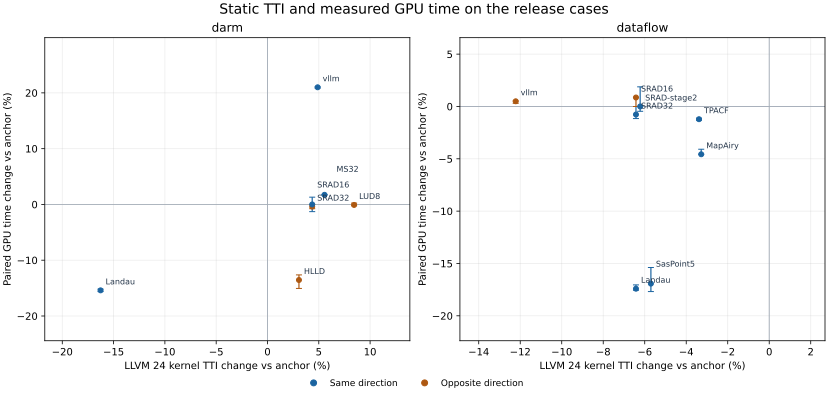

# 第 11 步：anchor 原生布局与发布线复验

发布复验覆盖 17 个 case、21 个 GPU 场景。原始、anchor、darm 和 dataflow 的 84 个场景变体均通过设备输出与 CPU 基准的全量比较。anchor-unified 只做静态评估。

dataflow 的整核 TTI 相对 anchor 有 **11 降 / 6 平 / 0 升**。两种策略合计检查 609 次存在可接受原生布局的 B2B 提交，发现 0 次同父 IR 上界违反。另有 189 次 B2B 提交没有可接受的原生布局。

## 发布线总表

百分比均相对 anchor，GPU 时间使用配对中位数及其 95% bootstrap 区间。只对静态 TTI 绝对变化超过 1% 的 darm 和 dataflow 做性能测量。多场景 case 的总表使用 vllm 64K、Landau mixed、SasPoint5 interval-mixture，其余场景随后单列。

| Case | 原始 TTI | anchor TTI | darm TTI | dataflow TTI | darm ΔTTI | dataflow ΔTTI | darm ΔGPU [95%] | dataflow ΔGPU [95%] |
| --- | --- | --- | --- | --- | --- | --- | --- | --- |
| vllm | 5423 | 2619 | 2747 | 2299 | +128 (+4.89%) | -320 (-12.22%) | +21.00% [+20.85%, +21.08%] | +0.49% [+0.30%, +0.53%] |
| MapAiry | 6402 | 3997 | 3999 | 3866 | +2 (+0.05%) | -131 (-3.28%) | — | -4.57% [-4.57%, -4.08%] |
| tigre | 1182 | 942 | 948 | 942 | +6 (+0.64%) | +0 (+0.00%) | — | — |
| HLLD | 1854 | 1696 | 1748 | 1696 | +52 (+3.07%) | +0 (+0.00%) | -13.55% [-15.06%, -12.63%] | — |
| NQU64 | 289 | 274 | 274 | 274 | +0 (+0.00%) | +0 (+0.00%) | — | — |
| MS32 | 370 | 198 | 209 | 198 | +11 (+5.56%) | +0 (+0.00%) | +1.73% [+1.72%, +1.74%] | — |
| PCM32 | 1392 | 1136 | 1136 | 1136 | +0 (+0.00%) | +0 (+0.00%) | — | — |
| SRAD16 | 484 | 436 | 455 | 408 | +19 (+4.36%) | -28 (-6.42%) | +0.00% [-1.29%, +1.30%] | +0.86% [+0.00%, +0.87%] |
| SRAD32 | 484 | 436 | 455 | 408 | +19 (+4.36%) | -28 (-6.42%) | -0.39% [-0.77%, +0.00%] | -0.77% [-1.15%, +0.00%] |
| Landau | 4737 | 1635 | 1369 | 1530 | -266 (-16.27%) | -105 (-6.42%) | -15.40% [-15.62%, -15.18%] | -17.41% [-17.56%, -17.04%] |
| SW2D | 1926 | 1925 | 1925 | 1924 | +0 (+0.00%) | -1 (-0.05%) | — | — |
| CED | 348 | 281 | 282 | 281 | +1 (+0.36%) | +0 (+0.00%) | — | — |
| TPACF | 592 | 325 | 325 | 314 | +0 (+0.00%) | -11 (-3.38%) | — | -1.22% [-1.32%, -1.12%] |
| SRAD-stage2 | 232 | 209 | 210 | 196 | +1 (+0.48%) | -13 (-6.22%) | — | +0.00% [-0.46%, +1.88%] |
| SasPoint5 | 854 | 491 | 493 | 463 | +2 (+0.41%) | -28 (-5.70%) | — | -16.92% [-17.68%, -15.38%] |
| HiPIMS-George | 5588 | 5572 | 5577 | 5537 | +5 (+0.09%) | -35 (-0.63%) | — | — |
| LUD8 | 819 | 628 | 681 | 624 | +53 (+8.44%) | -4 (-0.64%) | -0.09% [-0.23%, +0.24%] | — |

## 配对、生成与路径

anchor-unified 与 anchor 的差值包含统一生成及其引起的提交路径变化。dataflow 与 anchor-unified 的差值包含新增配对候选及其引起的路径变化。分叉指首个不同的提交候选，或一条路径先结束的步骤。正差表示 TTI 升高。

| Case | 原始/anchor/darm/anchor-unified/dataflow 提交数 | anchor-unified TTI | 生成差 | 配对差 | dataflow 首次分叉及最终变化 | anchor-unified 首次分叉 |
| --- | --- | --- | --- | --- | --- | --- |
| vllm | 0/225/225/275/275 | 2299 | -320 | +0 | 226 / 降低 | 226 |
| MapAiry | 0/30/27/34/32 | 3955 | -42 | -89 | 3 / 降低 | 29 |
| tigre | 0/5/5/5/5 | 942 | +0 | +0 | — / 持平 | — |
| HLLD | 0/5/3/5/5 | 1696 | +0 | +0 | — / 持平 | — |
| NQU64 | 0/2/2/2/2 | 274 | +0 | +0 | — / 持平 | — |
| MS32 | 0/2/2/2/2 | 198 | +0 | +0 | — / 持平 | — |
| PCM32 | 0/18/18/18/18 | 1136 | +0 | +0 | — / 持平 | — |
| SRAD16 | 0/4/3/10/10 | 408 | -28 | +0 | 5 / 降低 | 5 |
| SRAD32 | 0/4/3/10/10 | 408 | -28 | +0 | 5 / 降低 | 5 |
| Landau | 0/22/21/21/22 | 1641 | +6 | -111 | 5 / 降低 | 16 |
| SW2D | 0/1/1/1/1 | 1925 | +0 | -1 | 1 / 降低 | — |
| CED | 0/3/3/3/3 | 281 | +0 | +0 | — / 持平 | — |
| TPACF | 0/23/23/25/25 | 314 | -11 | +0 | 24 / 降低 | 24 |
| SRAD-stage2 | 0/2/2/5/5 | 196 | -13 | +0 | 3 / 降低 | 3 |
| SasPoint5 | 0/7/8/9/12 | 478 | -13 | -15 | 8 / 降低 | 8 |
| HiPIMS-George | 0/5/3/25/24 | 5539 | -33 | -2 | 4 / 降低 | 6 |
| LUD8 | 0/2/2/4/4 | 624 | -4 | +0 | 2 / 降低 | 2 |

## 同一父 IR 的迁移检查

按实际通过 anchor 接受条件的原生布局比较整核 TTI。非 B2B、正规化提交和无可接受原生布局的 B2B 不计入上界的分母。

| 策略 | 有原生报价的提交 | 违反上界 |
| --- | --- | --- |
| anchor-unified | 300 | 0 |
| dataflow | 309 | 0 |

MapAiry 第 10c 步的两个精确父 IR 已纳入回归。第 8 步得到 4700（历史统一生成 4705），第 9 步得到 4639（历史统一生成 4669）。

## HiPIMS-George 回填

第 10c 步的 168 个历史失败布局已全部按新回填路径重放并报价。独立 LLVM 模块中的命名聚合类型在同一个 LLVM context 中被重新创建，typed pointer 因类型标识不同而在入口检查失败。新路径逐层验证并映射原 ABI 类型。其余 6 次历史未返回布局的请求在原版本和修正版本上均成功重放。历史日志缺少子进程退出码，无法确定这 6 次失败的原始原因。新版本记录这些诊断。本步 HiPIMS-George 的 anchor-unified 与 dataflow 分别报价 2149 和 4636 个统一布局，两个完整重跑均未重现上述失败。

## 每个 case 的来源、ISA 与正确性

ISA 计数只包含目标 kernel 符号内的静态机器指令。条件分支与 exec 计数可以重叠。NVIDIA 用 SASS 条件分支与每线程寄存器数，AMD 专用列用 — 表示。完整逐步记录与 GPU 窗口中位数见 [证据 JSON](step11-evidence.json.gz)。

### vllm

- B2B 配对来源为 `anchor`×224, `dataflow`×50。布局为 `all-speculate`×16, `min-cut`×34, `native`×224。
- 第 226 步分叉。anchor 为 已结束，dataflow 为 `cache_eval:B9:B11:B10` (2619 → 2603)。终点 TTI 2619 → 2299。
- CPU 基准与 GPU 输出全量一致，已覆盖 vllm-128K, vllm-64K。

| 变体 | 条件分支 | exec | VALU | SALU | v_cndmask | VGPR | SGPR | CUDA 寄存器/线程 |
| --- | --- | --- | --- | --- | --- | --- | --- | --- |
| original | 307 | 1787 | 1787 | 1590 | 76 | 62 | 82 | — |
| anchor | 115 | 415 | 1685 | 408 | 376 | 55 | 76 | — |
| darm | 115 | 415 | 2033 | 408 | 568 | 53 | 76 | — |
| dataflow | 65 | 261 | 1689 | 304 | 432 | 55 | 76 | — |

| 场景 | anchor µs | darm µs | darm Δ[95%] | dataflow µs | dataflow Δ[95%] |
| --- | --- | --- | --- | --- | --- |
| vllm-128K | 4260.079 | 5136.075 | +20.71% [+20.32%, +21.04%] | 4272.078 | +0.38% [+0.06%, +0.70%] |
| vllm-64K | 2133.122 | 2578.640 | +21.00% [+20.85%, +21.08%] | 2143.281 | +0.49% [+0.30%, +0.53%] |

### MapAiry

- B2B 配对来源为 `anchor`×12, `darm`×7, `dataflow`×5。布局为 `all-speculate`×12, `native`×12。
- 第 3 步分叉。anchor 为 `evaluate:B102:B101:B103` (5898 → 5646)，dataflow 为 `evaluate:B98:B97:B99` (5856 → 5583)。终点 TTI 3997 → 3866。
- 第 1 步已有报价差异。
- CPU 基准与 GPU 输出全量一致，已覆盖 MapAiry-65539。

| 变体 | 条件分支 | exec | VALU | SALU | v_cndmask | VGPR | SGPR | CUDA 寄存器/线程 |
| --- | --- | --- | --- | --- | --- | --- | --- | --- |
| original | 99 | 362 | 3177 | 1281 | 108 | 37 | 44 | — |
| anchor | 67 | 246 | 2460 | 744 | 333 | 75 | 46 | — |
| darm | 69 | 267 | 2559 | 741 | 438 | 35 | 46 | — |
| dataflow | 60 | 221 | 2483 | 719 | 402 | 51 | 46 | — |

| 场景 | anchor µs | darm µs | darm Δ[95%] | dataflow µs | dataflow Δ[95%] |
| --- | --- | --- | --- | --- | --- |
| MapAiry-65539 | 31.520 | — | — | 30.080 | -4.57% [-4.57%, -4.08%] |

### tigre

- B2B 配对来源为 `anchor`×2。布局为 `native`×2。
- 没有提交候选分叉。终点 TTI 942 → 942。
- CPU 基准与 GPU 输出全量一致，已覆盖 tigre-head64。

| 变体 | 条件分支 | exec | VALU | SALU | v_cndmask | VGPR | SGPR | CUDA 寄存器/线程 |
| --- | --- | --- | --- | --- | --- | --- | --- | --- |
| original | 28 | 98 | 1265 | 152 | 209 | 45 | 54 | — |
| anchor | 18 | 51 | 980 | 98 | 185 | 44 | 50 | — |
| darm | 20 | 59 | 986 | 105 | 176 | 45 | 50 | — |
| dataflow | 18 | 51 | 980 | 98 | 185 | 44 | 50 | — |

### HLLD

- B2B 配对来源为 `anchor`×1。布局为 `native-inherited`×1。
- 没有提交候选分叉。终点 TTI 1696 → 1696。
- CPU 基准与 GPU 输出全量一致，已覆盖 HLLD-65536。

| 变体 | 条件分支 | exec | VALU | SALU | v_cndmask | VGPR | SGPR | CUDA 寄存器/线程 |
| --- | --- | --- | --- | --- | --- | --- | --- | --- |
| original | 24 | 60 | 1023 | 116 | 28 | 126 | 29 | — |
| anchor | 17 | 34 | 1041 | 100 | 227 | 134 | 32 | — |
| darm | 19 | 42 | 984 | 106 | 86 | 126 | 30 | — |
| dataflow | 17 | 34 | 1041 | 100 | 227 | 134 | 32 | — |

| 场景 | anchor µs | darm µs | darm Δ[95%] | dataflow µs | dataflow Δ[95%] |
| --- | --- | --- | --- | --- | --- |
| HLLD-65536 | 74.480 | 63.680 | -13.55% [-15.06%, -12.63%] | — | — |

### NQU64

- B2B 配对来源为 无。布局为 无。
- 没有提交候选分叉。终点 TTI 274 → 274。
- CPU 基准与 GPU 输出全量一致，已覆盖 NQU64。

| 变体 | 条件分支 | exec | VALU | SALU | v_cndmask | VGPR | SGPR | CUDA 寄存器/线程 |
| --- | --- | --- | --- | --- | --- | --- | --- | --- |
| original | 13 | 49 | 69 | 47 | 0 | 10 | 22 | — |
| anchor | 11 | 38 | 66 | 43 | 3 | 10 | 22 | — |
| darm | 11 | 38 | 66 | 43 | 3 | 10 | 22 | — |
| dataflow | 11 | 38 | 66 | 43 | 3 | 10 | 22 | — |

### MS32

- B2B 配对来源为 `anchor`×1。布局为 `native`×1。
- 没有提交候选分叉。终点 TTI 198 → 198。
- CPU 基准与 GPU 输出全量一致，已覆盖 MS32。

| 变体 | 条件分支 | exec | VALU | SALU | v_cndmask | VGPR | SGPR | CUDA 寄存器/线程 |
| --- | --- | --- | --- | --- | --- | --- | --- | --- |
| original | 7 | 24 | 97 | 45 | 6 | 28 | 36 | — |
| anchor | 6 | 20 | 89 | 41 | 16 | 27 | 36 | — |
| darm | 7 | 22 | 89 | 43 | 8 | 25 | 36 | — |
| dataflow | 6 | 20 | 89 | 41 | 16 | 27 | 36 | — |

| 场景 | anchor µs | darm µs | darm Δ[95%] | dataflow µs | dataflow Δ[95%] |
| --- | --- | --- | --- | --- | --- |
| MS32 | 928378.662 | 944428.192 | +1.73% [+1.72%, +1.74%] | — | — |

### PCM32

- B2B 配对来源为 `anchor`×17。布局为 `native`×16, `native-inherited`×1。
- 没有提交候选分叉。终点 TTI 1136 → 1136。
- CPU 基准与 GPU 输出全量一致，已覆盖 PCM32。

| 变体 | 条件分支 | exec | VALU | SALU | v_cndmask | VGPR | SGPR | CUDA 寄存器/线程 |
| --- | --- | --- | --- | --- | --- | --- | --- | --- |
| original | 38 | 136 | 352 | 145 | 40 | 23 | 24 | — |
| anchor | 17 | 32 | 355 | 77 | 122 | 25 | 30 | — |
| darm | 17 | 32 | 355 | 77 | 122 | 25 | 30 | — |
| dataflow | 17 | 32 | 355 | 77 | 122 | 25 | 30 | — |

### SRAD16

- B2B 配对来源为 `anchor`×5, `dataflow`×5。布局为 `all-speculate`×5, `native`×5。
- 第 5 步分叉。anchor 为 已结束，dataflow 为 `_Z11srad_cuda_1PfS_S_S_S_S_iif:B21:B23:B22` (436 → 433)。终点 TTI 436 → 408。
- CPU 基准与 GPU 输出全量一致，已覆盖 SRAD16-256。

| 变体 | 条件分支 | exec | VALU | SALU | v_cndmask | VGPR | SGPR | CUDA 寄存器/线程 |
| --- | --- | --- | --- | --- | --- | --- | --- | --- |
| original | 21 | 58 | 264 | 90 | 6 | 19 | 32 | — |
| anchor | 18 | 35 | 273 | 67 | 19 | 19 | 30 | — |
| darm | 19 | 41 | 272 | 75 | 15 | 19 | 30 | — |
| dataflow | 15 | 21 | 279 | 58 | 37 | 20 | 30 | — |

| 场景 | anchor µs | darm µs | darm Δ[95%] | dataflow µs | dataflow Δ[95%] |
| --- | --- | --- | --- | --- | --- |
| SRAD16-256 | 18.560 | 18.560 | +0.00% [-1.29%, +1.30%] | 18.560 | +0.86% [+0.00%, +0.87%] |

### SRAD32

- B2B 配对来源为 `anchor`×5, `dataflow`×5。布局为 `all-speculate`×5, `native`×5。
- 第 5 步分叉。anchor 为 已结束，dataflow 为 `_Z11srad_cuda_1PfS_S_S_S_S_iif:B21:B23:B22` (436 → 433)。终点 TTI 436 → 408。
- CPU 基准与 GPU 输出全量一致，已覆盖 SRAD32-256。

| 变体 | 条件分支 | exec | VALU | SALU | v_cndmask | VGPR | SGPR | CUDA 寄存器/线程 |
| --- | --- | --- | --- | --- | --- | --- | --- | --- |
| original | 21 | 58 | 264 | 90 | 6 | 19 | 32 | — |
| anchor | 18 | 35 | 273 | 67 | 19 | 19 | 30 | — |
| darm | 19 | 41 | 272 | 75 | 15 | 19 | 30 | — |
| dataflow | 15 | 21 | 280 | 58 | 37 | 20 | 30 | — |

| 场景 | anchor µs | darm µs | darm Δ[95%] | dataflow µs | dataflow Δ[95%] |
| --- | --- | --- | --- | --- | --- |
| SRAD32-256 | 20.800 | 20.640 | -0.39% [-0.77%, +0.00%] | 20.640 | -0.77% [-1.15%, +0.00%] |

### Landau

- B2B 配对来源为 `anchor`×10, `darm`×9, `dataflow`×3。布局为 `all-protect`×3, `all-speculate`×10, `native`×8, `native-inherited`×1。
- 第 5 步分叉。anchor 为 `evaluate:B31:B30:B32` (3715 → 3463)，dataflow 为 `evaluate:B27:B26:B28` (3627 → 3354)。终点 TTI 1635 → 1530。
- 第 1 步已有报价差异。
- CPU 基准与 GPU 输出全量一致，已覆盖 Landau-coherent, Landau-mixed。

| 变体 | 条件分支 | exec | VALU | SALU | v_cndmask | VGPR | SGPR | CUDA 寄存器/线程 |
| --- | --- | --- | --- | --- | --- | --- | --- | --- |
| original | 44 | 151 | 2461 | 972 | 88 | 22 | 44 | — |
| anchor | 19 | 62 | 1543 | 235 | 374 | 66 | 30 | — |
| darm | 23 | 100 | 1560 | 213 | 543 | 47 | 40 | — |
| dataflow | 17 | 56 | 1578 | 239 | 431 | 60 | 44 | — |

| 场景 | anchor µs | darm µs | darm Δ[95%] | dataflow µs | dataflow Δ[95%] |
| --- | --- | --- | --- | --- | --- |
| Landau-coherent | 20.800 | 23.360 | +12.31% [+12.31%, +12.70%] | 23.040 | +10.77% [+10.77%, +11.54%] |
| Landau-mixed | 35.840 | 30.319 | -15.40% [-15.62%, -15.18%] | 29.600 | -17.41% [-17.56%, -17.04%] |

### SW2D

- B2B 配对来源为 `dataflow`×1。布局为 `min-cut`×1。
- 第 1 步分叉。anchor 为 `normalize:_Z4fluxPdddPiS_S0_S0_S_S_S_S_S_S_S_S_S_S_S_S_iiiddd:%683:0` (1926 → 1925)，dataflow 为 `_Z4fluxPdddPiS_S0_S0_S_S_S_S_S_S_S_S_S_S_S_S_iiiddd:B35:B36:B37` (1926 → 1924)。终点 TTI 1925 → 1924。
- CPU 基准与 GPU 输出全量一致，已覆盖 SW2D-258x259。

| 变体 | 条件分支 | exec | VALU | SALU | v_cndmask | VGPR | SGPR | CUDA 寄存器/线程 |
| --- | --- | --- | --- | --- | --- | --- | --- | --- |
| original | 35 | 354 | 1336 | 514 | 71 | 64 | 104 | — |
| anchor | 35 | 354 | 1336 | 514 | 71 | 64 | 104 | — |
| darm | 35 | 354 | 1336 | 514 | 71 | 64 | 104 | — |
| dataflow | 35 | 363 | 1338 | 534 | 71 | 64 | 104 | — |

### CED

- B2B 配对来源为 `anchor`×2。布局为 `native-inherited`×2。
- 没有提交候选分叉。终点 TTI 281 → 281。
- CPU 基准与 GPU 输出全量一致，已覆盖 CED-110。

| 变体 | 条件分支 | exec | VALU | SALU | v_cndmask | VGPR | SGPR | CUDA 寄存器/线程 |
| --- | --- | --- | --- | --- | --- | --- | --- | --- |
| original | 29 | 111 | 83 | 107 | 4 | 14 | 18 | — |
| anchor | 20 | 81 | 92 | 87 | 15 | 15 | 18 | — |
| darm | 20 | 81 | 93 | 87 | 16 | 15 | 18 | — |
| dataflow | 20 | 81 | 92 | 87 | 15 | 15 | 18 | — |

### TPACF

- B2B 配对来源为 `anchor`×1, `dataflow`×2。布局为 `min-cut`×2, `native`×1。
- 第 24 步分叉。anchor 为 已结束，dataflow 为 `ACFKernel:B19:B20:B7` (325 → 319)。终点 TTI 325 → 314。
- CPU 基准与 GPU 输出全量一致，已覆盖 TPACF-16384。

| 变体 | 条件分支 | exec | VALU | SALU | v_cndmask | VGPR | SGPR | CUDA 寄存器/线程 |
| --- | --- | --- | --- | --- | --- | --- | --- | --- |
| original | 32 | 182 | 176 | 207 | 0 | 16 | 104 | — |
| anchor | 11 | 44 | 252 | 96 | 37 | 16 | 104 | — |
| darm | 11 | 44 | 252 | 96 | 37 | 16 | 104 | — |
| dataflow | 11 | 42 | 248 | 92 | 37 | 16 | 104 | — |

| 场景 | anchor µs | darm µs | darm Δ[95%] | dataflow µs | dataflow Δ[95%] |
| --- | --- | --- | --- | --- | --- |
| TPACF-16384 | 10178.714 | — | — | 10058.634 | -1.22% [-1.32%, -1.12%] |

### SRAD-stage2

- B2B 配对来源为 `anchor`×2, `dataflow`×3。布局为 `all-speculate`×3, `native`×2。
- 第 3 步分叉。anchor 为 已结束，dataflow 为 `_Z11srad_cuda_2PfS_S_S_S_S_iiff:B0:B1:B2` (209 → 208)。终点 TTI 209 → 196。
- CPU 基准与 GPU 输出全量一致，已覆盖 SRAD-stage2-256。

| 变体 | 条件分支 | exec | VALU | SALU | v_cndmask | VGPR | SGPR | CUDA 寄存器/线程 |
| --- | --- | --- | --- | --- | --- | --- | --- | --- |
| original | 6 | 22 | 131 | 40 | 6 | 16 | 26 | — |
| anchor | 4 | 10 | 132 | 28 | 9 | 16 | 26 | — |
| darm | 5 | 11 | 138 | 28 | 12 | 16 | 26 | — |
| dataflow | 4 | 8 | 130 | 25 | 11 | 18 | 26 | — |

| 场景 | anchor µs | darm µs | darm Δ[95%] | dataflow µs | dataflow Δ[95%] |
| --- | --- | --- | --- | --- | --- |
| SRAD-stage2-256 | 17.120 | — | — | 17.280 | +0.00% [-0.46%, +1.88%] |

### SasPoint5

- B2B 配对来源为 `anchor`×7, `darm`×1, `dataflow`×4。布局为 `all-protect`×4, `min-cut`×1, `native`×7。
- 第 8 步分叉。anchor 为 已结束，dataflow 为 `evaluate:B5:B11:B12` (482 → 480)。终点 TTI 491 → 463。
- 第 6 步已有报价差异。
- CPU 基准与 GPU 输出全量一致，已覆盖 SasPoint5-coherent-blocks, SasPoint5-interval-mixture, SasPoint5-uniform-01。

| 变体 | 条件分支 | exec | VALU | SALU | v_cndmask | VGPR | SGPR | CUDA 寄存器/线程 |
| --- | --- | --- | --- | --- | --- | --- | --- | --- |
| original | 35 | — | — | — | — | — | — | 26 |
| anchor | 22 | — | — | — | — | — | — | 34 |
| darm | 22 | — | — | — | — | — | — | 38 |
| dataflow | 23 | — | — | — | — | — | — | 40 |

同机有外部 CUDA 进程。主场景追加同一 anchor 对象的 A/A 对照，配对时间差为 +0.00% [-1.53%, +2.87%]。

| 场景 | anchor µs | darm µs | darm Δ[95%] | dataflow µs | dataflow Δ[95%] |
| --- | --- | --- | --- | --- | --- |
| SasPoint5-coherent-blocks | 23.552 | — | — | 23.552 | +0.00% [+0.00%, +4.10%] |
| SasPoint5-interval-mixture | 66.560 | — | — | 55.296 | -16.92% [-17.68%, -15.38%] |
| SasPoint5-uniform-01 | 51.200 | — | — | 39.936 | -21.78% [-22.00%, -20.48%] |

### HiPIMS-George

- B2B 配对来源为 `anchor`×1, `dataflow`×22。布局为 `all-protect`×2, `all-speculate`×5, `convex-guard`×15, `native`×1。
- 第 4 步分叉。anchor 为 `_ZN2GC2fv36cuAdvectionSWEsGeorgeCartesianKernelEPdS1_S1_S1_S1_PNS_7Vector2ES3_jPNS_15ShortDualHandleEjS1_S1_S3_:B308:B309:B310` (5577 → 5575)，dataflow 为 `_ZN2GC2fv36cuAdvectionSWEsGeorgeCartesianKernelEPdS1_S1_S1_S1_PNS_7Vector2ES3_jPNS_15ShortDualHandleEjS1_S1_S3_:B313:B314:B315` (5575 → 5570)。终点 TTI 5572 → 5537。
- 第 3 步已有报价差异。
- CPU 基准与 GPU 输出全量一致，已覆盖 HiPIMS-George。

| 变体 | 条件分支 | exec | VALU | SALU | v_cndmask | VGPR | SGPR | CUDA 寄存器/线程 |
| --- | --- | --- | --- | --- | --- | --- | --- | --- |
| original | 140 | — | — | — | — | — | — | 130 |
| anchor | 136 | — | — | — | — | — | — | 130 |
| darm | 139 | — | — | — | — | — | — | 130 |
| dataflow | 134 | — | — | — | — | — | — | 142 |

### LUD8

- B2B 配对来源为 `anchor`×3, `dataflow`×1。布局为 `all-speculate`×1, `convex-guard`×1, `native`×2。
- 第 2 步分叉。anchor 为 `_Z13lud_perimeterPfii:B3:B4:B5` (666 → 628)，dataflow 为 `_Z13lud_perimeterPfii:B0:B1:B2` (666 → 654)。终点 TTI 628 → 624。
- CPU 基准与 GPU 输出全量一致，已覆盖 LUD8-16384。

| 变体 | 条件分支 | exec | VALU | SALU | v_cndmask | VGPR | SGPR | CUDA 寄存器/线程 |
| --- | --- | --- | --- | --- | --- | --- | --- | --- |
| original | 6 | 21 | 399 | 99 | 0 | 31 | 23 | — |
| anchor | 3 | 10 | 356 | 26 | 24 | 47 | 16 | — |
| darm | 4 | 16 | 376 | 25 | 37 | 34 | 18 | — |
| dataflow | 3 | 10 | 357 | 26 | 25 | 47 | 16 | — |

| 场景 | anchor µs | darm µs | darm Δ[95%] | dataflow µs | dataflow Δ[95%] |
| --- | --- | --- | --- | --- | --- |
| LUD8-16384 | 460950.150 | 460573.578 | -0.09% [-0.23%, +0.24%] | — | — |

## 静态 TTI 与 GPU 时间

图按策略分面。每个已测量 case 在同一分面仅保留主场景的一个点，竖线为 95% 区间。橙色点表示静态变化与 GPU 时间点估计方向相反。

dataflow 主场景较快 **4**，95% 区间含 0 **3**，较慢 **1**。

点估计方向相反的 case 为 vllm (dataflow), HLLD (darm), SRAD16 (dataflow), SRAD32 (darm), LUD8 (darm)。区间完全落在相反方向的 case 为 vllm (dataflow), HLLD (darm)。

## 结论

17 个 case 的整核报价合计从 anchor 的 22800 变为 anchor-unified 的 22314（-486），再变为 dataflow 的 22096（-218）。dataflow 相对 anchor 的合计变化为 -704（-3.09%）。统一生成与其引起的路径变化贡献了基准差额的 69%，加入新配对与 DARM 配对候选后的差额占 31%。这是静态 TTI 加总，GPU 测量按 case 独立报告。

dataflow 的 B2B 提交合计配对来源为 `anchor` 293 次、`darm` 17 次、`dataflow` 101 次。布局来源为 `all-protect` 9 次、`all-speculate` 57 次、`convex-guard` 16 次、`min-cut` 38 次、`native` 286 次、`native-inherited` 5 次。

触发计时门槛的 dataflow 主场景时间变化介于 -17.41% 和 +0.86%，中位数为 -0.99%。

静态 TTI 下降但 GPU 计时未确认较快的 dataflow case 为 vllm, SRAD16, SRAD32, SRAD-stage2。
